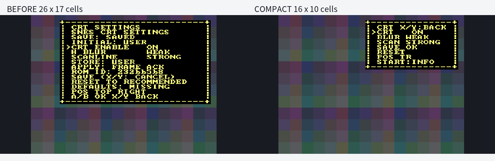

# OSD2の小型表示とSTART補助表示

2026年11月7日。全機種のOSD1/OSD2を日本語化しないという利用者方針を採用する。既存の日本語一覧とtitles.csv順序は維持する。今回の対象はNES/SNESで共有するOSD2の表示。OSD1の英語文言・操作・geometry、映像効果と保存engineは維持する。

## 表示と操作

通常表示を26×17から16×10文字へ縮小した。枠の占有面積は63.8%減。既存8×8 fontと文字の大きさは変えず、必要な行だけを表示する。

```text
CRT X/Y:BACK
  CRT   ON
  BLUR  WEAK
  SCAN  STRONG
  SAVE OK
  RESET
  POS TR
START:INFO
```

START単独の押下で補助表示を開閉する。保持中は反転を繰り返さず、収納すると枠も16×10へ戻る。選択項目・preview・保存状態・OSD位置は保持する。STARTとA/B・方向等の同時押しは編集やSAVEへ渡さず、全解放を待つ。X/Yの取消しは優先して維持する。OSDを開き直すと通常表示から始まる。

補助表示は24×17文字で、通常の操作行に続いてSAVE状態、INITIAL、STORE、APPLY、ROM ID、DEFAULTS、RESETの意味を表示する。これらを隠していてもframe ACKの照会・再送は続く。補助表示の開閉は設定送信やSD保存を行わない。INITIAL/STOREの起動時snapshotという現仕様と、SYSTEM/GLOBALや異常表示の実機確認は、今回の表示縮小と別の作業として残す。

`CRT ENABLE`は`CRT`、`H BLUR`は`BLUR`、`SCANLINE`は`SCAN`、`STANDARD`は`STD`へ短縮する。`RESET TO RECOMMENDED`は`RESET`とし、補助表示に`RESET = RECOMMENDED`を示す。Resetは従来どおり推奨値のpreviewで、modeの保存には別途SAVEが必要。

SAVE行は保存済みなら`SAVE OK`、未保存なら`SAVE *`、失敗なら`SAVE FAILED`。推奨値をまだUSERとして固定していなければ`SAVE`、保存を許可しないsessionでは`SAVE N/A`となる。保存失敗は通常表示でも隠さない。POSはC/TL/TR/BL/BRへ短縮し、5位置と電源断までの保持方針は従来どおり。

## PCでの検証

共有firmware commitは`8bf3c7037ee5df457919be939de0c0c285ba5d99`。関連host試験15組が合格し、OSD1、CRT保存/復元/Reset、一覧・日本語・CSV順序、起動adapter、SNES loader、storage/UARTを回帰した。新しいUI試験ではNES/SNESそれぞれ全32設定・5位置の小型表示、補助情報の非表示/表示、SAVE状態、START保持・同時押し、実文字RAM書込み、選択位置維持、枠を消さない更新、収納時の正確な縮小復帰を確認した。

firmwareは230,960byte、SHA256 `1416dba4ae61e0656d590f46025473301bee8f285f48772cde0988175b141e06`。production 99fileをcommit/build入力と照合し、実ELFのSDH wrapperも確認した。NES/SNES/monitorのFPGA source・imageは変更せず、新しいFPGA build/timingとして扱わない。実機導入保護30件も合格した。

比較画像はproduction C++から生成した実際のframeと既存FPGA fontを使うPC previewで、背景は仮画像。実機合格の代わりにはしない。



## 実機導入と確認

実機は未導入・未確認。SD全65fileと全flashを新しく退避し、確認済みS4cとの一致を確認してからfirmwareだけを更新する。FPGA image、一時metadata、実USER/Reset record、NES設定は変更しない。

SNES確認はスーパーマリオコレクション・USB P1の1回の起動へまとめる。通常の小型表示、5位置、STARTの保持・開閉と縮小復帰、preview、X/Y取消し、Reset previewを確認する。SAVEは保存済み・無変更の状態だけで行い、同値省略とstay-openを確認する。新たなUSER値の保存やmetadata変更は行わない。続いてNESを1回起動し、同じ共有UIを回帰する。SNESの追加起動は依頼しない。

最後にSDを新しく読取り退避し、全65file・属性と実USER/Reset recordの不変を照合する。公開済みのS4c合格tagは保持し、小型UIをその実機合格結果へ混ぜない。

## 実機導入前の退避

同日、SDを再識別して全65fileを新しく退避し、S4cの最終snapshotとの全内容・属性の一致を確認した。独立した全4MiB flashの2回の読取りは一致し、確認済みS4c全flashとも同じだった。書込み直前の追加読取りも新しい退避と一致した。

SNES imageは現物・退避・payloadのSHA256が同じであり、helperのcopy分岐へ入らず保持した。全65file・属性と実USER/Reset recordに変更はなく、SD/firmwareへの書込みはまだ0回。新しいBOOT接続を受けてからfirmwareだけを更新する。詳細は`pre-install-backups.json`。

## 実機導入記録

同日、新しいBOOT接続で小型OSD2 firmwareを0x40000へ1回だけ書き込んだ。全4MiBを読戻し、firmware全byteとcustom領域外の不変を確認した。SDは全65file・属性が新しい退避およびS4cの最終snapshotと一致し、SD書込みは0回。FPGA image、titles.csv、実USER/Reset recordは変更していない。flash utilityの原file復元も照合した。

実機での通常表示・START開閉・縮小復帰・preview・操作は未確認であり、PC結果から合格を推定しない。詳細は`deployment.json`。
